# Multivariate State Space Models

[](https://github.com/boennecd/mssm/actions/workflows/R-CMD-check.yaml) [](https://CRAN.R-project.org/package=mssm) [](https://cranlogs.r-pkg.org/)

mssm estimates multivariate state space models of this form.

$$y_{it} \sim g(\eta_{it}),\qquad i\in I_t$$

$$\eta_{it} = \vec\gamma^\top\vec x_{it} + \vec\beta_t^\top\vec z_{it}$$

$$\vec\beta_t = F\vec\beta_{t-1} + \vec\epsilon_t,\qquad \vec\epsilon_t\sim N(\vec 0, Q)$$

Here $g$ is the observation distribution, and $t=1,\dots,T$ indexes the observed periods. At each period $t$, the index set $I_t$, outcomes $y_{it}$, and covariates $\vec x_{it}$ and $\vec z_{it}$ are known. The observation vector is $\vec y_t = \lbrace y_{it} \rbrace_{i\in I_t}$. The state $\vec\beta_t$ can also be multivariate. The package scales with the number of observations per period. It uses independent particle filters as in Lin et al. (2005) and approximates gradients and observed information as in Poyiadjis et al. (2011).

## Installation

The package requires R 4.1.0 or later.

Install the current source from GitHub.

``` r
devtools::install_github(repo = "boennecd/mssm")
```

Install the package from CRAN.

``` r
install.packages(pkgs = "mssm")
```

## Table of Contents

- [Installation](#installation)
- [Poisson Example](#poisson-example)
  - [Log-Likelihood Approximations](#log-likelihood-approximations)
  - [Antithetic Variables](#antithetic-variables)
  - [Parameter Estimation](#parameter-estimation)
  - [Faster Approximation](#faster-approximation)
  - [Approximate Observed Information Matrix](#approximate-observed-information-matrix)
- [Supported Families](#supported-families)
- [Fast Sum-Kernel Approximation](#fast-sum-kernel-approximation)
- [Function Definitions](#function-definitions)
- [References](#references)

## Poisson Example

This example uses simulated Poisson counts to fit and assess a state space model.

``` r
# simulate path of state variables 
set.seed(78727269)
n_periods <- 312L
(F. <- matrix(c(.5, .1, 0, .8), 2L))
```

    ##      [,1] [,2]
    ## [1,]  0.5  0.0
    ## [2,]  0.1  0.8

``` r
(Q <- matrix(c(.5^2, .1, .1, .7^2), 2L))
```

    ##      [,1] [,2]
    ## [1,] 0.25 0.10
    ## [2,] 0.10 0.49

``` r
(Q_0 <- matrix(c(0.333, 0.194, 0.194, 1.46), 2L))
```

    ##       [,1]  [,2]
    ## [1,] 0.333 0.194
    ## [2,] 0.194 1.460

``` r
betas <- cbind(crossprod(chol(Q_0),        rnorm(2L)                      ), 
               crossprod(chol(Q  ), matrix(rnorm((n_periods - 1L) * 2), 2)))
betas <- t(betas)
for(i in 2:nrow(betas))
  betas[i, ] <- betas[i, ] + F. %*% betas[i - 1L, ]
par(mar = c(5, 4, 1, 1))
matplot(betas, lty = 1, type = "l")
```

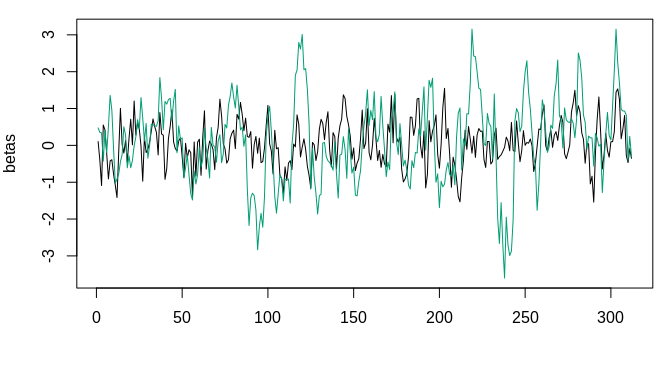

``` r
# simulate observations
cfix <- c(-1, .2, .5, -1) # gamma
n_obs <- 100L
dat <- lapply(1:n_obs, function(id){
  x <- runif(n_periods, -1, 1)
  X <- cbind(X1 = x, X2 = runif(1, -1, 1))
  z <- runif(n_periods, -1, 1)
  
  eta <- drop(cbind(1, X, z) %*% cfix + rowSums(cbind(1, z) * betas))
  y <- rpois(n_periods, lambda = exp(eta))
  
  # randomly drop some
  keep <- .2 > runif(n_periods)
  
  data.frame(y = y, X, Z = z, id = id, time_idx = 1:n_periods)[keep, ]
})
dat <- do.call(rbind, dat)

# show some properties 
nrow(dat)
```

    ## [1] 6242

``` r
head(dat)
```

    ##    y      X1     X2       Z id time_idx
    ## 2  0  0.5685 0.9272  0.9845  1        2
    ## 3  0 -0.2260 0.9272  0.1585  1        3
    ## 4  1 -0.7234 0.9272  0.4847  1        4
    ## 5  1 -0.3010 0.9272 -0.6352  1        5
    ## 8  2 -0.4437 0.9272  0.8311  1        8
    ## 13 1  0.2834 0.9272  0.7135  1       13

``` r
table(dat$y)
```

    ## 
    ##    0    1    2    3    4    5    6    7    8    9   10   11   12   13   14 
    ## 3881 1479  486  180   83   54   32    8    7    6    6    2    3    3    2 
    ##   15   16   17   20   21   24   26   28 
    ##    2    1    1    2    1    1    1    1

``` r
# quick smooth of number of events vs. time
par(mar = c(5, 4, 1, 1))
plot(smooth.spline(dat$time_idx, dat$y), type = "l", xlab = "Time", 
     ylab = "Number of events")
```

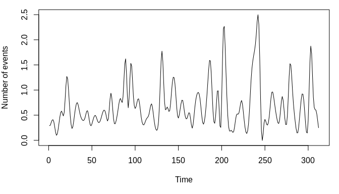

``` r
# and split by those with `Z` above and below 0
with(dat, {
  z_large <- ifelse(Z > 0, "large", "small")
  smooths <- lapply(split(cbind(dat, z_large), z_large), function(x){
    plot(smooth.spline(x$time_idx, x$y), type = "l", xlab = "Time", 
     ylab = paste("Number of events -", unique(x$z_large)))
  })
})
```

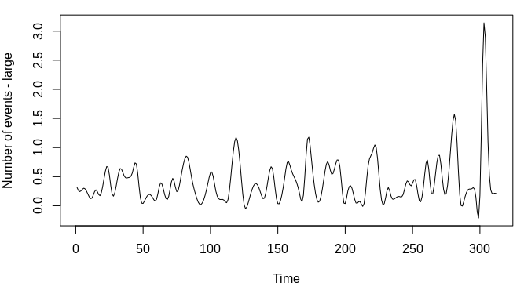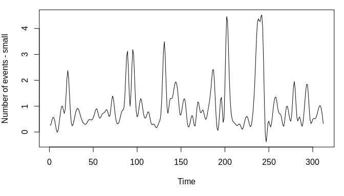

In the above, we simulate 312 (`n_periods`) with 100 (`n_obs`) individuals. Each individual has a fixed covariate, `X2`, and two time-varying covariates, `X1` and `Z`. One of the time-varying covariates, `Z`, has a random slope. Further, the intercept is also random.

### Log-Likelihood Approximations

We start by estimating a generalized linear model without random effects.

``` r
glm_fit <- glm(y ~ X1 + X2 + Z, poisson(), dat)
summary(glm_fit)
```

    ## 
    ## Call:
    ## glm(formula = y ~ X1 + X2 + Z, family = poisson(), data = dat)
    ## 
    ## Deviance Residuals: 
    ##    Min      1Q  Median      3Q     Max  
    ## -2.266  -1.088  -0.767   0.395  10.913  
    ## 
    ## Coefficients:
    ##             Estimate Std. Error z value Pr(>|z|)    
    ## (Intercept)  -0.5558     0.0180  -30.82  < 2e-16 ***
    ## X1            0.2024     0.0265    7.62  2.4e-14 ***
    ## X2            0.5160     0.0275   18.78  < 2e-16 ***
    ## Z            -0.9122     0.0286  -31.90  < 2e-16 ***
    ## ---
    ## Signif. codes:  0 '***' 0.001 '**' 0.01 '*' 0.05 '.' 0.1 ' ' 1
    ## 
    ## (Dispersion parameter for poisson family taken to be 1)
    ## 
    ##     Null deviance: 10989.1  on 6241  degrees of freedom
    ## Residual deviance:  9427.1  on 6238  degrees of freedom
    ## AIC: 14977
    ## 
    ## Number of Fisher Scoring iterations: 6

``` r
logLik(glm_fit)
```

    ## 'log Lik.' -7485 (df=4)

Use the particle filter from `mssm()` to approximate the log-likelihood at the parameters used to simulate the data.

``` r
library(mssm)
ll_func <- mssm(
  fixed = y ~ X1 + X2 + Z, family = poisson(), data = dat, 
  # make it explict that there is an intercept (not needed)
  random = ~ 1 + Z, ti = time_idx, control = mssm_control(
    n_threads = 5L, N_part = 500L, what = "log_density"))

system.time(
  mssm_obj <- ll_func$pf_filter(
    cfix = cfix, disp = numeric(), F. = F., Q = Q))
```

    ##    user  system elapsed 
    ##   2.047   0.011   0.527

``` r
# returns the log-likelihood approximation
logLik(mssm_obj)
```

    ## 'log Lik.' -5865 (df=11)

``` r
# also shown by print
mssm_obj
```

    ## 
    ## Call:  mssm(fixed = y ~ X1 + X2 + Z, family = poisson(), data = dat, 
    ##     random = ~1 + Z, ti = time_idx, control = mssm_control(n_threads = 5L, 
    ##         N_part = 500L, what = "log_density"))
    ## 
    ## Family is 'poisson' with link 'log'.
    ## State vector is assumed to be X_t ~ N(F * X_(t-1), Q).
    ## 
    ## F is
    ##             (Intercept)   Z
    ## (Intercept)         0.5 0.0
    ## Z                   0.1 0.8
    ## 
    ## Q's standard deviations are
    ## (Intercept)           Z 
    ##         0.5         0.7 
    ## 
    ## Q's correlation matrix is (lower triangle is shown)
    ##   (Intercept)
    ## Z       0.286
    ## 
    ## Fixed coefficients are
    ## (Intercept)          X1          X2           Z 
    ##        -1.0         0.2         0.5        -1.0 
    ## 
    ## Log-likelihood approximation is -5865
    ## 500 particles are used and summary statistics for effective sample sizes are
    ##   Mean      458.4
    ##   sd         22.1
    ##   Min       325.7
    ##   Max       484.8
    ## 
    ## Number of parameters           11
    ## Number of observations       6242

The particle filter gives a higher log-likelihood than the generalized linear model in this example. Compare the predicted states and prediction intervals with the simulated states in the plots.

``` r
# get predicted mean and prediction interval 
filter_means <- plot(mssm_obj, do_plot = FALSE)

# plot with which also contains the true paths
for(i in 1:ncol(betas)){
  be <- betas[, i]
  me <- filter_means$means[i, ]
  lb <- filter_means$lbs[i, ]
  ub <- filter_means$ubs[i, ]
  
  #     dashed: true paths
  # continuous: predicted mean from filter distribution 
  #     dotted: prediction interval
  par(mar = c(5, 4, 1, 1))
  matplot(cbind(be, me, lb, ub), lty = c(2, 1, 3, 3), type = "l", 
          col = "black", ylab = rownames(filter_means$lbs)[i])
}
```

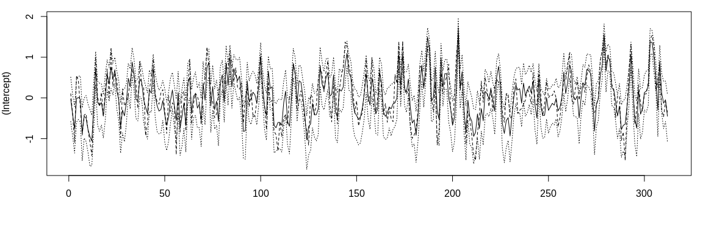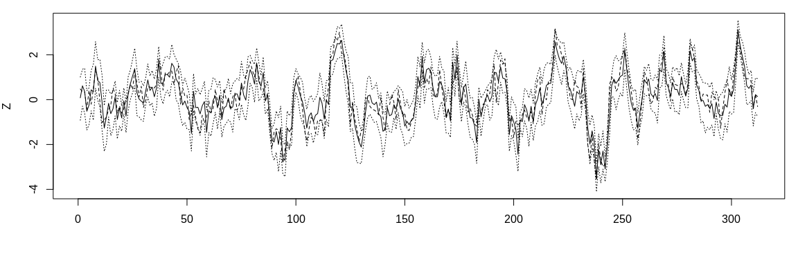

We can also get predicted values from the smoothing distribution.

``` r
# get smoothing weights
mssm_obj <- ll_func$smoother(mssm_obj)

# get predicted mean and prediction interval from smoothing distribution
smooth_means <- plot(mssm_obj, do_plot = FALSE, which_weights = "smooth")

for(i in 1:ncol(betas)){
  be  <- betas[, i]
  me  <- filter_means$means[i, ]
  lb  <- filter_means$lbs[i, ]
  ub  <- filter_means$ubs[i, ]
  mes <- smooth_means$means[i, ]
  lbs <- smooth_means$lbs[i, ]
  ubs <- smooth_means$ubs[i, ]
  
  #     dashed: true paths
  # continuous: predicted mean from filter distribution 
  #     dotted: prediction interval
  # 
  # smooth predictions are in a different color
  par(mar = c(5, 4, 1, 1))
  matplot(cbind(be, me, lb, ub, mes, lbs, ubs), 
          lty = c(2, 1, 3, 3, 1, 3, 3), type = "l", 
          col = c(rep(1, 4), rep(2, 3)), ylab = rownames(filter_means$lbs)[i])
}
```

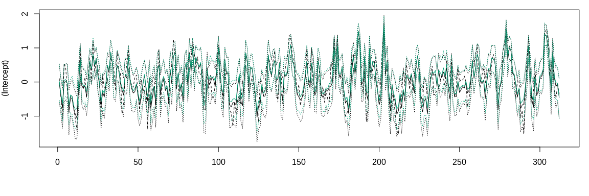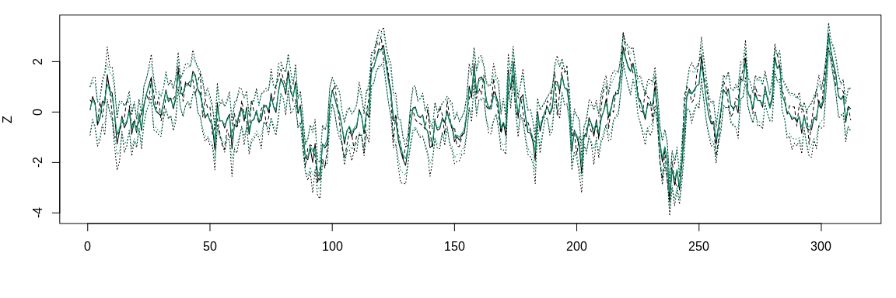

``` r
# compare mean square error of the two means
rbind(filter = colMeans((t(filter_means$means) - betas)^2), 
      smooth = colMeans((t(smooth_means$means) - betas)^2))
```

    ##        (Intercept)      Z
    ## filter      0.1035 0.2127
    ## smooth      0.1012 0.1906

We can get the effective sample size at each point in time with the `get_ess` function.

``` r
(ess <- get_ess(mssm_obj))
```

    ## Effective sample sizes
    ##   Mean      458.4
    ##   sd         22.1
    ##   Min       325.7
    ##   Max       484.8

``` r
plot(ess)
```

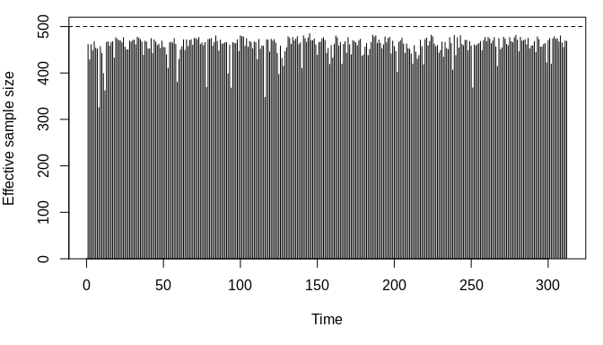

We can compare this what we get by using a so-called bootstrap (like) filter instead.

``` r
local({
  ll_boot <- mssm(
    fixed = y ~ X1 + X2 + Z, family = poisson(), data = dat, 
    random = ~ Z, ti = time_idx, control = mssm_control(
      n_threads = 5L, N_part = 500L, what = "log_density", 
      which_sampler = "bootstrap"))
  
  print(system.time(
    boot_fit <- ll_boot$pf_filter(
      cfix = coef(glm_fit), disp = numeric(), F. = F., Q = Q)))
  
  plot(get_ess(boot_fit))
})
```

    ##    user  system elapsed 
    ##   1.929   0.012   0.504

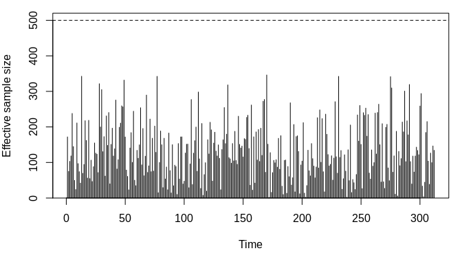

The above is not much faster (and maybe slower in this run) as the bulk of the computation is not in the sampling step. We can also compare the log-likelihood approximation with what we get if we choose parameters close to the GLM estimates.

``` r
mssm_glm <- ll_func$pf_filter(
  cfix = coef(glm_fit), disp = numeric(), F. = diag(1e-8, 2), 
  Q = diag(1e-4^2, 2))
logLik(mssm_glm)
```

    ## 'log Lik.' -7485 (df=11)

### Antithetic Variables

One way to reduce the variance of the Monte Carlo estimate is to use [antithetic variables](https://en.wikipedia.org/wiki/Antithetic_variates). The package uses the method from Durbin and Koopman (1997) to generate one variable balanced for location and two balanced for scale. This method uses a t-distribution as the proposal distribution.

Use a t-distribution with $\nu$ degrees of freedom, a $d$-dimensional mean $\vec\mu$, and a scale matrix $\Sigma$ to generate a sample $\vec x$.

$$\begin{aligned}
\vec x &= \vec\mu + C \frac{\vec z}{\sqrt{a / \nu}} & \Sigma &= CC^\top \\
\vec z &\sim N(\vec 0, I) & a &\sim \chi^2_\nu
\end{aligned}$$

The variable balanced for location is

$$\widehat{\vec x} = \vec\mu - C \frac{\vec z}{\sqrt{a / \nu}}$$

The variables balanced for scale use this statistic.

$$u = \frac{\vec z^\top\vec z/ d}{a / \nu} \sim F(d, \nu)$$

Let $Q$ be the cumulative distribution function of $U$.

$$k = P(U \leq u) = Q(u)$$

Use its inverse to get the quantile at $1 - k$.

$$u' = Q^{-1}(1 - k)$$

The two variables balanced for scale are

$$\begin{aligned}
\widetilde{\vec x}_1 &= \vec\mu + \sqrt{u'/u} \cdot C \frac{\vec z}{\sqrt{a / \nu}} \\
\widetilde{\vec x}_2 &= \vec\mu - \sqrt{u'/u} \cdot C \frac{\vec z}{\sqrt{a / \nu}}
\end{aligned}$$

We will illustrate the reduction in variance of the log-likelihood estimate. To do so, we run the particle filter with and without antithetic variables multiple times below to get an estimate of the error of the approximation.

``` r
set.seed(12769550)
compare_anti <- local({
  ll_func_no_anti <- mssm(
    fixed = y ~ X1 + X2 + Z, family = poisson(), data = dat, 
    random = ~ Z, ti = time_idx, control = mssm_control(
      n_threads = 5L, N_part = 500L, what = "log_density")) 
  
  ll_func_anti <- mssm(
    fixed = y ~ X1 + X2 + Z, family = poisson(), data = dat,
    random = ~ Z, ti = time_idx, control = mssm_control(
      n_threads = 5L, N_part = 500L, what = "log_density", 
      use_antithetic = TRUE)) 
  
  no_anti <- replicate(
    100, {
      ti <- system.time(x <- logLik(ll_func_no_anti$pf_filter(
        cfix = cfix, disp = numeric(), F. = F., Q = Q, seed = NULL)))
      list(ti = ti, x = x)
    }, simplify = FALSE)
  w_anti  <- replicate(
    100, {
      ti <- system.time(x <- logLik(ll_func_anti$pf_filter(
        cfix = cfix, disp = numeric(), F. = F., Q = Q, seed = NULL)))
      list(ti = ti, x = x)
    }, simplify = FALSE)
  
  list(no_anti = no_anti, w_anti = w_anti)
})
```

The mean estimate of the log-likelihood and standard error of the estimate is shown below with and without antithetic variables.

``` r
sapply(compare_anti, function(x){ 
  x <- sapply(x, "[[", "x")
  c(mean = mean(x), se = sd(x) / sqrt(length(x)))
})
```

    ##          no_anti     w_anti
    ## mean -5864.42610 -5864.3495
    ## se       0.05163     0.0298

Using antithetic variables is slower. Below we show summary statistics for the elapsed time without using antithetic variables and with antithetic variables.

``` r
sapply(compare_anti, function(x){ 
  x <- sapply(x, "[[", "ti")
  z <- x[c("elapsed"), ]
  c(mean = mean(z), quantile(z, c(.5, .25, .75, 0, 1)))
})
```

    ##      no_anti w_anti
    ## mean  0.4878 0.5402
    ## 50%   0.4810 0.5340
    ## 25%   0.4695 0.5207
    ## 75%   0.4993 0.5553
    ## 0%    0.4400 0.4910
    ## 100%  0.5740 0.6560

### Parameter Estimation

We will need to estimate the parameters for real applications. We could do this e.g., with a Monte Carlo expectation-maximization algorithm or by using a Monte Carlo approximation of the gradient. Currently, the latter is only available and the user will have to write a custom function to perform the estimation. I will provide an example below. The `sgd` function is not a part of the package. Instead the package provides a way to approximate the gradient and allows the user to perform subsequent maximization (e.g., with constraints or penalties). The definition of the `sgd` is given at the end of this file as it is somewhat long. We start by using a Laplace approximation to get the starting values.

``` r
# setup mssmFunc object to use 
ll_func <- mssm(  
  fixed = y ~ X1 + X2 + Z, family = poisson(), data = dat, 
  random = ~ Z, ti = time_idx, control = mssm_control(
    n_threads = 5L, N_part = 200L, what = "gradient", use_antithetic = TRUE))

# use Laplace approximation to get starting values
system.time(
  sta <- ll_func$Laplace(
    F. = diag(.5, 2), Q = diag(1, 2), cfix = coef(glm_fit), disp = numeric()))
```

    ## Mode approxmation failed at least once

    ##    user  system elapsed 
    ##  31.220   0.636   7.832

``` r
# the function returns an object with the estimated parameters and  
# approximation log-likelihood
sta
```

    ## 
    ## Call:  mssm(fixed = y ~ X1 + X2 + Z, family = poisson(), data = dat, 
    ##     random = ~Z, ti = time_idx, control = mssm_control(n_threads = 5L, 
    ##         N_part = 200L, what = "gradient", use_antithetic = TRUE))
    ## 
    ## Family is 'poisson' with link 'log'.
    ## Parameters are estimated with a Laplace approximation.
    ## State vector is assumed to be X_t ~ N(F * X_(t-1), Q).
    ## 
    ## F estimate is
    ##             (Intercept)        Z
    ## (Intercept)     0.49174 -0.00466
    ## Z              -0.00831  0.79513
    ## 
    ## Q's standard deviations estimates are
    ## (Intercept)           Z 
    ##       0.547       0.703 
    ## 
    ## Q's correlation matrix estimates is (lower triangle is shown)
    ##   (Intercept)
    ## Z       0.325
    ## 
    ## Fixed coefficients estimates are
    ## (Intercept)          X1          X2           Z 
    ##      -0.910       0.213       0.523      -0.892 
    ## 
    ## Log-likelihood approximation is -5863 
    ## Number of parameters           11
    ## Number of observations       6242

``` r
sta$Q
```

    ##             (Intercept)      Z
    ## (Intercept)      0.2996 0.1251
    ## Z                0.1251 0.4940

<!--
library(knitr)
opts_knit$set(output.dir = ".")
opts_chunk$set(cache.path = paste0(
    file.path("README_cache", "markdown_github"), .Platform$file.sep))
load_cache("sgd")
-->
``` r
# use stochastic gradient descent with averaging
set.seed(25164416)
system.time( 
  res <- sgd(
    ll_func, F. = sta$F., Q = sta$Q, cfix = sta$cfix, 
    lrs = .001 * (1:50)^(-1/2), n_it = 50L, avg_start = 30L))
```

    ##    user  system elapsed 
    ## 227.520   1.236  53.674

``` r
# use Adam algorithm instead
set.seed(25164416)
system.time( 
  resa <- adam(
    ll_func, F. = sta$F., Q = sta$Q, cfix = sta$cfix, 
    lr = .01, n_it = 50L))
```

    ##    user  system elapsed 
    ## 227.604   1.283  53.607

Plots of the approximate log-likelihoods at each iteration is shown below along with the final estimates.

``` r
print(tail(res$logLik), digits = 6) # final log-likelihood approximations
```

    ## [1] -5862.05 -5861.92 -5861.79 -5861.78 -5861.54 -5861.59

``` r
par(mar = c(5, 4, 1, 1))
plot(res$logLik, type = "l", ylab = "log-likelihood approximation")
```

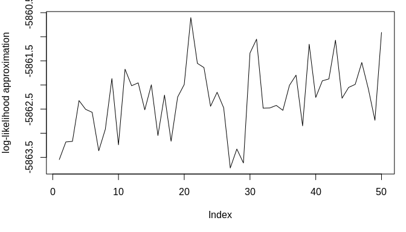

``` r
plot(res$grad_norm, type = "l", ylab = "approximate gradient norm")
```

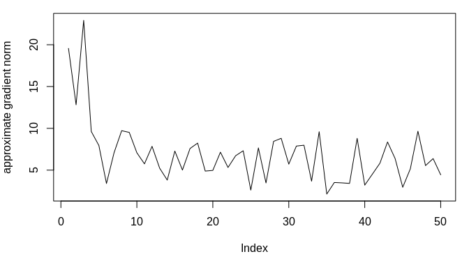

``` r
# final estimates
res$F. 
```

    ##             (Intercept)         Z
    ## (Intercept)   0.4957314 -0.001611
    ## Z            -0.0007354  0.799463

``` r
res$Q
```

    ##             (Intercept)      Z
    ## (Intercept)      0.3031 0.1243
    ## Z                0.1243 0.4970

``` r
res$cfix
```

    ## [1] -0.9740  0.2137  0.5240 -0.8984

``` r
# compare with output from Adam algorithm
print(tail(resa$logLik), digits = 6) # final log-likelihood approximations
```

    ## [1] -5862.07 -5861.94 -5861.81 -5861.79 -5861.56 -5861.65

``` r
plot(resa$logLik, type = "l", ylab = "log-likelihood approximation")
```

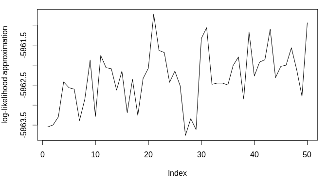

``` r
plot(resa$grad_norm, type = "l", ylab = "approximate gradient norm")
```

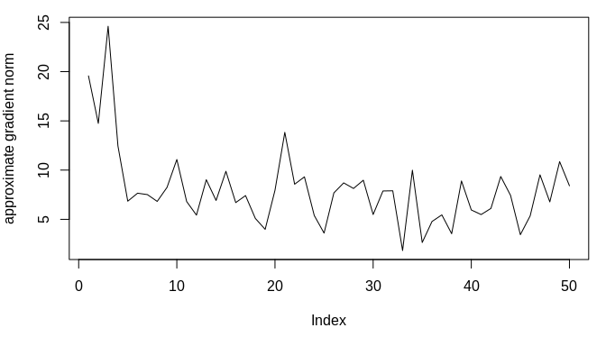

``` r
resa$F. 
```

    ##             (Intercept)         Z
    ## (Intercept)   0.4931484 -0.002659
    ## Z             0.0001808  0.800192

``` r
resa$Q
```

    ##             (Intercept)      Z
    ## (Intercept)      0.3069 0.1300
    ## Z                0.1300 0.4987

``` r
resa$cfix
```

    ## [1] -0.9840  0.2136  0.5245 -0.9396

We may want to use more particles towards the end when we estimate the parameters. To do, we use the approximation described in the next section at the final estimates that we arrived at before.

<!--
library(knitr)
opts_knit$set(output.dir = ".")
opts_chunk$set(cache.path = paste0(
    file.path("README_cache", "markdown_github"), .Platform$file.sep))
load_cache("cont_est")
-->
``` r
ll_func <- mssm(
  fixed = y ~ X1 + X2 + Z, family = poisson(), data = dat, 
  random = ~ Z, ti = time_idx, control = mssm_control(
    n_threads = 5L, N_part = 10000L, what = "gradient",
    which_ll_cp = "KD", aprx_eps = .01, use_antithetic = TRUE))

set.seed(25164416)
system.time( 
  res_final <- adam(
    ll_func, F. = resa$F., Q = resa$Q, cfix = resa$cfix, 
    lr = .001, n_it = 25L))
```

    ##    user  system elapsed 
    ## 2962.58   24.67  674.59

``` r
plot(res_final$logLik, type = "l", ylab = "log-likelihood approximation")
```

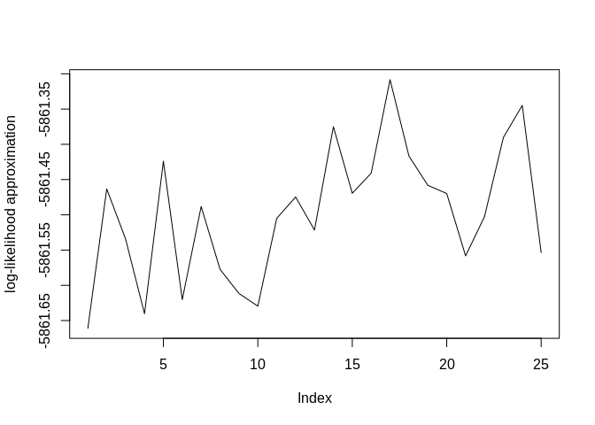

``` r
plot(res_final$grad_norm, type = "l", ylab = "approximate gradient norm")
```

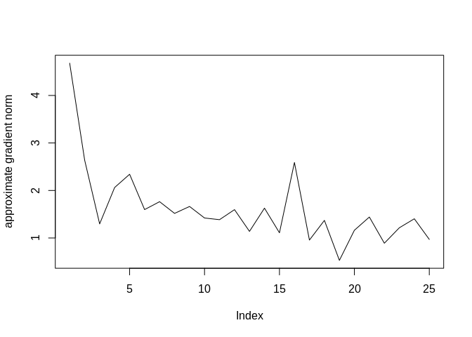

``` r
res_final$F. 
```

    ##             (Intercept)         Z
    ## (Intercept)    0.502139 -0.002061
    ## Z              0.007066  0.799001

``` r
res_final$Q
```

    ##             (Intercept)      Z
    ## (Intercept)      0.3032 0.1228
    ## Z                0.1228 0.4969

``` r
res_final$cfix
```

    ## [1] -0.9784  0.2136  0.5245 -0.9187

### Faster Approximation

One drawback with the particle filter we use is that it has $\mathcal{O}(N^2)$ computational complexity where $N$ is the number of particles. We can see this by changing the number of particles.

``` r
local({
  # assign function that returns a function that uses a given number of 
  # particles
  func <- function(N){
    ll_func <- mssm(
      fixed = y ~ X1 + X2 + Z, family = poisson(), data = dat, 
      random = ~ Z, ti = time_idx, control = mssm_control(
        n_threads = 5L, N_part = N, what = "log_density", 
        use_antithetic = TRUE))
    function()
      ll_func$pf_filter(
        cfix = coef(glm_fit), disp = numeric(), F. = diag(1e-8, 2), 
        Q = diag(1e-4^2, 2))
      
  }
  
  f_100  <- func( 100L)
  f_200  <- func( 200L)
  f_400  <- func( 400L)
  f_800  <- func( 800L)
  f_1600 <- func(1600L)
  
  # benchmark. Should ĩncrease at ~ N^2 rate
  microbenchmark::microbenchmark(
    `100` = f_100(), `200` = f_200(), `400` = f_400(), `800` = f_800(),
    `1600` = f_1600(), times = 3L)
})
```

    ## Unit: milliseconds
    ##  expr     min      lq    mean median      uq     max neval
    ##   100   68.76   69.48   69.86   70.2   70.42   70.63     3
    ##   200  147.95  153.14  159.71  158.3  165.59  172.86     3
    ##   400  367.42  370.75  372.86  374.1  375.58  377.09     3
    ##   800  973.96  974.70  996.01  975.4 1007.03 1038.61     3
    ##  1600 3268.12 3290.25 3304.28 3312.4 3322.36 3332.33     3

A solution is to use the dual k-d tree method I cover later. The computational complexity is $\mathcal{O}(N \log N)$ for this method which is somewhat indicated by the run times shown below.

``` r
local({
  # assign function that returns a function that uses a given number of 
  # particles
  func <- function(N){
    ll_func <- mssm(
      fixed = y ~ X1 + X2 + Z, family = poisson(), data = dat, 
      random = ~ Z, ti = time_idx, control = mssm_control(
        n_threads = 5L, N_part = N, what = "log_density", 
        which_ll_cp = "KD", KD_N_max = 6L, aprx_eps = 1e-2, 
        use_antithetic = TRUE))
    function()
      ll_func$pf_filter(
        cfix = coef(glm_fit), disp = numeric(), F. = diag(1e-8, 2), 
        Q = diag(1e-4^2, 2))
      
  }
  
  f_100   <- func(  100L)
  f_200   <- func(  200L)
  f_400   <- func(  400L)
  f_800   <- func(  800L)
  f_1600  <- func( 1600L)
  f_12800 <- func(12800L) # <-- much larger
  
  # benchmark. Should increase at ~ N log N rate
  microbenchmark::microbenchmark(
    `100` = f_100(), `200` = f_200(), `400` = f_400(), `800` = f_800(), 
    `1600` = f_1600(), `12800` = f_12800(), times = 3L)
})
```

    ## Unit: milliseconds
    ##   expr    min     lq   mean median     uq    max neval
    ##    100  123.1  124.9  127.2  126.6  129.3  131.9     3
    ##    200  214.3  215.1  216.4  216.0  217.5  219.0     3
    ##    400  451.1  452.1  453.1  453.1  454.0  455.0     3
    ##    800  909.7  917.3  924.3  924.9  931.6  938.2     3
    ##   1600 1663.5 1693.8 1708.2 1724.1 1730.6 1737.1     3
    ##  12800 9243.3 9261.2 9272.7 9279.1 9287.5 9295.8     3

The `aprx_eps` argument controls the approximation error. The complete likelihood treats $\vec\beta_1,\dots,\vec\beta_T$ as observed.

$$L = \mu_1(\vec\beta_1) g_1(\vec y_1 \mid \vec\beta_1)
    \prod_{t=2}^T \big[ f(\vec\beta_t \mid \vec\beta_{t-1}) g_t(\vec y_t \mid \vec\beta_t) \big]$$

Here $g_t$ is the conditional distribution of $\vec y_t$ given $\vec\beta_t$. The transition distribution is $f$, and $\mu_1$ is the initial distribution.

Let $w_t^{(j)}$ be the weight of particle $j$ at time $t$. Use $\vec\beta_t^{(j)}$ for particle $j$ at time $t$. The error in the approximation of $w_{t-1}^{(j)}f(\vec\beta_t^{(i)} \mid \vec\beta_{t-1}^{(j)})$ has this upper bound.

$$w_{t-1}^{(j)} \frac{u - l}{(u + l)/2}$$

The values $u$ and $l$ are upper and lower bounds on $f(\vec\beta_t^{(i)} \mid \vec\beta_{t-1}^{(j)})$. Compare the log-likelihood estimates at the parameters used to simulate the data.

``` r
ll_compare <- local({
  N_use <- 500L 
  # we alter the seed in each run. First, the exact method
  ll_no_approx <- sapply(1:200, function(seed){
    ll_func <- mssm(
      fixed = y ~ X1 + X2 + Z, family = poisson(), data = dat,
      random = ~ Z, ti = time_idx, control = mssm_control(
        n_threads = 5L, N_part = N_use, what = "log_density", 
        seed = seed, use_antithetic = TRUE))
    
    logLik(ll_func$pf_filter(
      cfix = cfix, disp = numeric(), F. = F., Q = Q))
  })
  
  # then the approximation
  ll_approx <- sapply(1:200, function(seed){
    ll_func <- mssm(
      fixed = y ~ X1 + X2 + Z, family = poisson(), data = dat,
      random = ~ Z, ti = time_idx, control = mssm_control(
        n_threads = 5L, N_part = N_use, what = "log_density", 
        KD_N_max = 6L, aprx_eps = 1e-2, seed = seed, 
        which_ll_cp = "KD", use_antithetic = TRUE))
    
    logLik(ll_func$pf_filter(
      cfix = cfix, disp = numeric(), F. = F., Q = Q))
  })
  
  list(ll_no_approx = ll_no_approx, ll_approx = ll_approx)
})
```

``` r
par(mar = c(5, 4, 1, 1))
hist(
  ll_compare$ll_no_approx, main = "", breaks = 20L, 
  xlab = "Log-likelihood approximation -- no aprox")
```

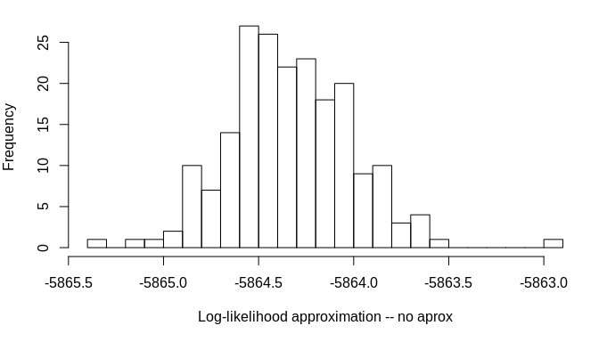

``` r
hist(
  ll_compare$ll_approx   , main = "", breaks = 20L, 
  xlab = "Log-likelihood approximation -- aprox")
```

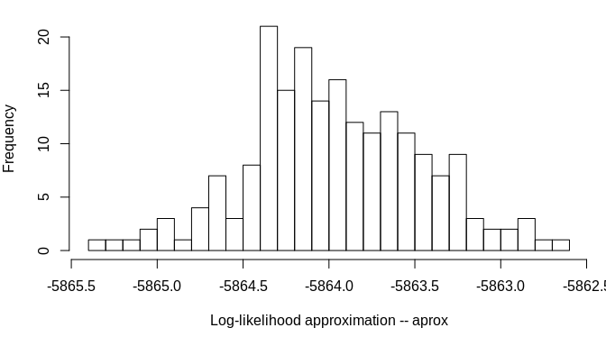

We can make a t-test for whether there is a difference between the two log-likelihood estimates

``` r
with(ll_compare, t.test(ll_no_approx, ll_approx))
```

    ## 
    ##  Welch Two Sample t-test
    ## 
    ## data:  ll_no_approx and ll_approx
    ## t = -14, df = 398, p-value <2e-16
    ## alternative hypothesis: true difference in means is not equal to 0
    ## 95 percent confidence interval:
    ##  -0.5129 -0.3847
    ## sample estimates:
    ## mean of x mean of y 
    ##     -5864     -5864

The fact that there may only be a small difference if any is nice because now we can get a much better approximation (in terms of variance) quickly of e.g., the log-likelihood as shown below.

``` r
ll_approx <- sapply(1:10, function(seed){
  N_use <- 10000L # many more particles
  
  ll_func <- mssm(
    fixed = y ~ X1 + X2 + Z, family = poisson(), data = dat,
    random = ~ Z, ti = time_idx, control = mssm_control(
      n_threads = 5L, N_part = N_use, what = "log_density", 
      KD_N_max = 100L, aprx_eps = 1e-2, seed = seed, 
      which_ll_cp = "KD", use_antithetic = TRUE))
  
  logLik(ll_func$pf_filter(
    cfix = cfix, disp = numeric(), F. = F., Q = Q))
}) 

# approximate log-likelihood
sd(ll_approx)
```

    ## [1] 0.07152

``` r
print(mean(ll_approx), digits = 6)
```

    ## [1] -5864

``` r
# compare sd with 
sd(ll_compare$ll_no_approx)
```

    ## [1] 0.3263

``` r
print(mean(ll_compare$ll_no_approx), digits = 6)
```

    ## [1] -5864.33

### Approximate Observed Information Matrix

Next, we look at approximating the observed information matrix with the method suggested by Poyiadjis, Doucet, and Singh (2011).

<!--
library(knitr)
opts_knit$set(output.dir = ".")
opts_chunk$set(cache.path = paste0(
    file.path("README_cache", "markdown_github"), .Platform$file.sep))
load_cache("apprx_obs_info")
-->
``` r
ll_func <- mssm(
  fixed = y ~ X1 + X2 + Z, family = poisson(), data = dat,
  random = ~ Z, ti = time_idx, control = mssm_control(
    n_threads = 5L, N_part = 10000L, what = "Hessian",
    which_ll_cp = "KD", aprx_eps = .01, use_antithetic = TRUE))

set.seed(46658529)
system.time(
  mssm_obs_info <- ll_func$pf_filter(
    cfix = res_final$cfix, disp = numeric(), F. = res_final$F., 
    Q = res_final$Q))
```

    ##    user  system elapsed 
    ## 352.638   1.183  77.434

We define a function below to get the approximate gradient and approximate observed information matrix from the returned object. Then we compare the output to the GLM we estimated and to the true parameters.

``` r
# Function to subtract the approximate gradient elements and approximate 
# observed information matrix. 
# 
# Args:
#   object: an object of class mssm.
#
# Returns:
#   list with the approximate gradient elements and approximate observed 
# information matrix. 
get_grad_n_obs_info <- function(object){
  stopifnot(inherits(object, "mssm"))

  # get dimension of the components
  n_rng   <- nrow(object$Z)
  dim_fix <- nrow(object$X)
  dim_rng <- n_rng * n_rng + ((n_rng + 1L) * n_rng) / 2L
  has_dispersion <-
    any(sapply(c("^Gamma", "^gaussian"), grepl, x = object$family))
  
  # get quantities for each particle
  quants <-     tail(object$pf_output, 1L)[[1L]]$stats
  ws     <- exp(tail(object$pf_output, 1L)[[1L]]$ws_normalized)

  # get mean estimates
  meas <- colSums(t(quants) * drop(ws))

  # separate out the different components. Start with the gradient
  idx <- dim_fix + dim_rng + has_dispersion
  grad <- meas[1:idx]
  dim_names <- names(grad)

  # then the observed information matrix
  I1 <- matrix(
    meas[-(1:idx)], dim_fix + dim_rng + has_dispersion, 
    dimnames = list(dim_names, dim_names))
  
  I2 <- matrix(0., nrow(I1), ncol(I1))
  for(i in seq_along(ws))
    I2 <- I2 + ws[i] * tcrossprod(quants[1:idx, i])

  list(grad = grad, obs_info = tcrossprod(grad) - I1 - I2)
}

# use function
out <- get_grad_n_obs_info(mssm_obs_info)

# approximate gradient
out$grad
```

    ##               (Intercept)                        X1 
    ##                  0.211341                  0.283541 
    ##                        X2                         Z 
    ##                  0.154870                  0.037114 
    ## F:(Intercept).(Intercept)           F:Z.(Intercept) 
    ##                  0.080264                 -0.236594 
    ##           F:(Intercept).Z                     F:Z.Z 
    ##                 -0.002054                  0.410972 
    ## Q:(Intercept).(Intercept)           Q:Z.(Intercept) 
    ##                 -0.361656                  0.654905 
    ##                     Q:Z.Z 
    ##                 -0.186215

``` r
# approximate standard errors
(ses <- sqrt(diag(solve(out$obs_info))))
```

    ##               (Intercept)                        X1 
    ##                   0.04401                   0.02815 
    ##                        X2                         Z 
    ##                   0.02920                   0.08919 
    ## F:(Intercept).(Intercept)           F:Z.(Intercept) 
    ##                   0.06737                   0.09086 
    ##           F:(Intercept).Z                     F:Z.Z 
    ##                   0.03278                   0.04176 
    ## Q:(Intercept).(Intercept)           Q:Z.(Intercept) 
    ##                   0.03625                   0.03951 
    ##                     Q:Z.Z 
    ##                   0.07010

``` r
# look at output for parameters in the observational equation. First, compare 
# with glm's standard errors
sqrt(diag(vcov(glm_fit)))
```

    ## (Intercept)          X1          X2           Z 
    ##     0.01803     0.02654     0.02747     0.02860

``` r
# and relative to true parameters vs. estimated
rbind(
  true             = cfix, 
  glm              = coef(glm_fit), 
  mssm             = res_final$cfix, 
  `standard error` = ses[1:4])
```

    ##                (Intercept)      X1     X2        Z
    ## true              -1.00000 0.20000 0.5000 -1.00000
    ## glm               -0.55576 0.20237 0.5160 -0.91216
    ## mssm              -0.97837 0.21359 0.5245 -0.91867
    ## standard error     0.04401 0.02815 0.0292  0.08919

``` r
# next look at parameters in state equation. First four are for F.
rbind(
  true             = c(F.), 
  mssm             = c(res_final$F.), 
  `standard error` = ses[5:8])
```

    ##                F:(Intercept).(Intercept) F:Z.(Intercept) F:(Intercept).Z
    ## true                             0.50000        0.100000        0.000000
    ## mssm                             0.50214        0.007066       -0.002061
    ## standard error                   0.06737        0.090857        0.032778
    ##                  F:Z.Z
    ## true           0.80000
    ## mssm           0.79900
    ## standard error 0.04176

``` r
# next three are w.r.t. the lower diagonal part of Q
rbind(
  true             =           Q[lower.tri(Q, diag = TRUE)], 
  mssm             = res_final$Q[lower.tri(Q, diag = TRUE)], 
  `standard error` = ses[9:11])
```

    ##                Q:(Intercept).(Intercept) Q:Z.(Intercept)  Q:Z.Z
    ## true                             0.25000         0.10000 0.4900
    ## mssm                             0.30322         0.12282 0.4969
    ## standard error                   0.03625         0.03951 0.0701

Supported Families
------------------

The following families are supported:

-   The binomial distribution is supported with logit, probit, and cloglog link.
-   The Poisson distribution is supported with square root and log link.
-   The gamma distribution is supported with log link.
-   The normal distribution with identity link (to compare with e.g., a Kalman filter), log link, and the inverse link function.

Fast Sum-Kernel Approximation
-----------------------------

The package uses the dual-tree method from Gray and Moore (2003) and Klaas et al. (2006) to approximate sums of weighted kernel values. Let $\lbrace \vec Y_i \rbrace_{i=1,\dots,N_q}$ be the query particles and $\lbrace \vec X_j \rbrace_{j=1,\dots,N_s}$ be the source particles. The normalized weight for each query particle is

$$W_i = \frac{\tilde W_i}{\sum_{k = 1}^{N_q} \tilde W_k},\qquad
\tilde W_i = \sum_{j=1}^{N_s} \bar W_j K(\vec Y_i, \vec X_j)$$

Each source particle has a weight $\bar W_j$, and $K$ is a kernel. Direct evaluation takes $\mathcal{O}(N_sN_q)$ operations. The method uses a [k-d tree](https://en.wikipedia.org/wiki/K-d_tree) for each set of particles.

- $\bar W_j K(\vec Y_i, \vec X_j)$ is close to zero for some pairs of nodes in the two k-d trees.
- $K(\cdot, \vec X_j)$ varies little within some nodes of the source tree.

Thus, a substantial amount of computation can be skipped or approximated with e.g., the centroid in the source node with only a minor loss of precision. The dual-tree approximation method is $\mathcal{O}(N_s\log N_s)$ and $\mathcal{O}(N_q\log N_q)$. We start by defining a function to simulate the source and query particles (we will let the two sets be identical for simplicity). Further, we plot one draw of simulated points and illustrate the leafs in the k-d tree.

``` r
######
# define function to simulate data
mus <- matrix(c(-1, -1, 
                 1, 1, 
                -1, 1), 3L, byrow = FALSE)
mus <- mus * .75
Sig <- diag(c(.5^2, .25^2))

get_sims <- function(n_per_grp){
  # simulate X
  sims <- lapply(1:nrow(mus), function(i){
    mu <- mus[i, ]
    X <- matrix(rnorm(n_per_grp * 2L), nrow = 2L)
    X <- t(crossprod(chol(Sig), X) + mu)
    
    data.frame(X, grp = i)
  })
  sims <- do.call(rbind, sims)
  X <- t(as.matrix(sims[, c("X1", "X2")]))
  
  # simulate weights
  ws <- exp(rnorm(ncol(X)))
  ws <- ws / sum(ws)
  
  list(sims = sims, X = X, ws = ws)
}

#####
# show example 
set.seed(42452654)
invisible(list2env(get_sims(5000L), environment()))

# plot points
par(mar = c(5, 4, 1, 1))
plot(as.matrix(sims[, c("X1", "X2")]), col = sims$grp + 1L)

# find k-d tree and add borders 
out <- mssm:::test_KD_note(X, 50L)
out$indices <- out$indices + 1L
n_ele <- drop(out$n_elems)
idx <- mapply(`:`, cumsum(c(1L, head(n_ele, -1))), cumsum(n_ele))
stopifnot(all(sapply(idx, length) == n_ele))
idx <- lapply(idx, function(i) out$indices[i])
stopifnot(!anyDuplicated(unlist(idx)), length(unlist(idx)) == ncol(X))

grps <- lapply(idx, function(i) X[, i])

borders <- lapply(grps, function(x) apply(x, 1, range))
invisible(lapply(borders, function(b) 
  rect(b[1, "X1"], b[1, "X2"], b[2, "X1"], b[2, "X2"])))
```

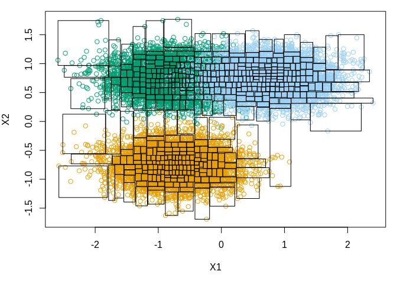

Next, we compute the run-times for the previous examples and compare the approximations of the un-normalized log weights, $\log \tilde W_i$, and normalized weights, $W_i$. The `n_threads` sets the number of threads to use in the methods.

``` r
# run-times
microbenchmark::microbenchmark(
  `dual tree 1` = mssm:::FSKA (X = X, ws = ws, Y = X, N_min = 10L, 
                               eps = 5e-3, n_threads = 1L),
  `dual tree 4` = mssm:::FSKA (X = X, ws = ws, Y = X, N_min = 10L, 
                               eps = 5e-3, n_threads = 4L),
  `naive 1`     = mssm:::naive(X = X, ws = ws, Y = X, n_threads = 1L),
  `naive 4`     = mssm:::naive(X = X, ws = ws, Y = X, n_threads = 4L),
  times = 10L)
```

    ## Unit: milliseconds
    ##         expr     min      lq   mean  median      uq     max neval
    ##  dual tree 1  109.58  114.52  126.6  115.53  118.07  232.78    10
    ##  dual tree 4   40.79   41.55   47.2   43.36   48.48   66.86    10
    ##      naive 1 3263.74 3523.12 3556.4 3556.02 3647.89 3743.59    10
    ##      naive 4  898.78  976.93 1335.7 1138.00 1286.56 3342.69    10

``` r
# The functions return the un-normalized log weights. We first compare
# the result on this scale
o1 <- mssm:::FSKA  (X = X, ws = ws, Y = X, N_min = 10L, eps = 5e-3, 
                    n_threads = 1L)
o2 <- mssm:::naive(X = X, ws = ws, Y = X, n_threads = 4L)

all.equal(o1, o2)
```

    ## [1] "Mean relative difference: 0.0015"

``` r
par(mar = c(5, 4, 1, 1))
hist((o1 - o2)/ abs((o1 + o2) / 2), breaks = 50, main = "", 
     xlab = "Delta un-normalized log weights")
```

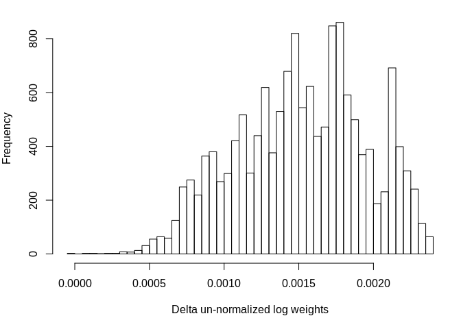

``` r
# then we compare the normalized weights
func <- function(x){
  x_max <- max(x)
  x <- exp(x - x_max)
  x / sum(x)
}

o1 <- func(o1)
o2 <- func(o2)
all.equal(o1, o2)
```

    ## [1] "Mean relative difference: 0.0008531"

``` r
hist((o1 - o2)/ abs((o1 + o2) / 2), breaks = 50, main = "", 
     xlab = "Delta normalized log weights")
```

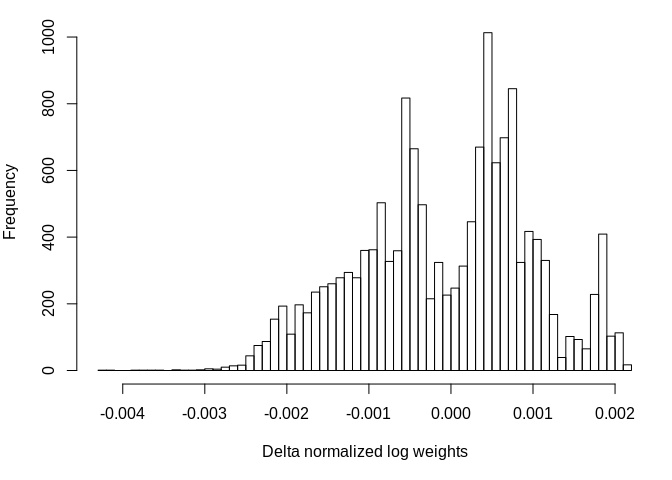

Finally, we compare the run-times as function of $N = N_s = N_q$. The dashed line is "naive" method, the continuous line is the dual-tree method, and the dotted line is dual-tree method using 1 thread.

``` r
Ns <- 2^(7:14)
run_times <- lapply(Ns, function(N){ 
  invisible(list2env(get_sims(N), environment()))
  microbenchmark::microbenchmark(
    `dual-tree`   = mssm:::FSKA (X = X, ws = ws, Y = X, N_min = 10L, eps = 5e-3, 
                                 n_threads = 4L),
    naive         = mssm:::naive(X = X, ws = ws, Y = X, n_threads = 4L),
    `dual-tree 1` = mssm:::FSKA (X = X, ws = ws, Y = X, N_min = 10L, eps = 5e-3, 
                                 n_threads = 1L), 
    times = 5L)
}) 

Ns_xtra <- 2^(15:19) 
run_times_xtra <- lapply(Ns_xtra, function(N){
  invisible(list2env(get_sims(N), environment()))
  microbenchmark::microbenchmark(
    `dual-tree` = mssm:::FSKA (X = X, ws = ws, Y = X, N_min = 10L, eps = 5e-3, 
                               n_threads = 4L),
    times = 5L)
}) 
```

``` r
library(microbenchmark)
meds <- t(sapply(run_times, function(x) summary(x, unit = "s")[, "median"]))
meds_xtra <- 
  sapply(run_times_xtra, function(x) summary(x, unit = "s")[, "median"])
meds <- rbind(meds, cbind(meds_xtra, NA_real_, NA_real_))
dimnames(meds) <- list(
  N = c(Ns, Ns_xtra) * 3L, method = c("Dual-tree", "Naive", "Dual-tree 1"))
meds
```

    ##          method
    ## N         Dual-tree     Naive Dual-tree 1
    ##   384      0.001715  0.001659    0.003271
    ##   768      0.003062  0.002737    0.006856
    ##   1536     0.005478  0.009643    0.011102
    ##   3072     0.010753  0.051587    0.026246
    ##   6144     0.022150  0.166788    0.049191
    ##   12288    0.035632  0.665132    0.092363
    ##   24576    0.062067  2.560118    0.173363
    ##   49152    0.114004 10.363843    0.330979
    ##   98304    0.220485        NA          NA
    ##   196608   0.481767        NA          NA
    ##   393216   0.921783        NA          NA
    ##   786432   1.824274        NA          NA
    ##   1572864  3.924601        NA          NA

``` r
par(mar = c(5, 4, 1, 1))
matplot(c(Ns, Ns_xtra) * 3L, meds, lty = 1:3, type = "l", log = "xy", 
        ylab = "seconds", xlab = "N", col = "black")
```

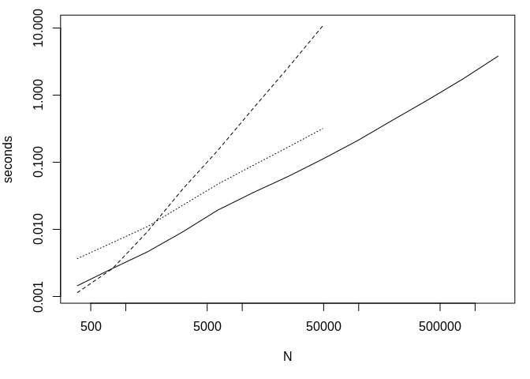

Function Definitions
--------------------

``` r
# Stochastic gradient descent for mssm object. The function assumes that the 
# state vector is stationary. The default values are rather arbitrary.
# 
# Args:
#   object: an object of class mssmFunc. 
#   n_it: number of iterations. 
#   lrs: learning rates to use. Must have n_it elements. Like problem specific. 
#   avg_start: index to start averaging. See Polyak et al. (1992) for arguments
#              for averaging.
#   cfix: starting values for fixed coefficients. 
#   F.: starting value for transition matrix in conditional distribution of the 
#       current state given the previous state.
#   Q: starting value for covariance matrix in conditional distribution of the 
#      current state given the previous. 
#   verbose: TRUE if output should be printed during estmation. 
#   disp: starting value for dispersion parameter.
# 
# Returns:
#   List with estimates and the log-likelihood approximation at each iteration. 
sgd <- function(
  object, n_it = 150L, 
  lrs = 1e-2 * (1:n_it)^(-1/2), avg_start = max(1L, as.integer(n_it * 4L / 5L)),
  cfix, F., Q,  verbose = FALSE, disp = numeric())
{
  # make checks
  stopifnot(
    inherits(object, "mssmFunc"), object$control$what == "gradient", n_it > 0L, 
    all(lrs > 0.), avg_start > 1L, length(lrs) == n_it)
  n_fix <- nrow(object$X)
  n_rng <- nrow(object$Z)
  
  # objects for estimates at each iteration, gradient norms, and
  # log-likelihood approximations
  has_dispersion <-
    any(sapply(c("^Gamma", "^gaussian"), grepl, x = object$family))
  n_params <-
    has_dispersion + n_fix + n_rng * n_rng + n_rng * (n_rng  + 1L) / 2L
  ests <- matrix(NA_real_, n_it + 1L, n_params)
  ests[1L, ] <- c(
    cfix,  if(has_dispersion) disp else NULL, F.,
    Q[lower.tri(Q, diag = TRUE)])
  grad_norm <- lls <- rep(NA_real_, n_it)
  
  # indices of the different components
  idx_fix   <- 1:n_fix
  if(has_dispersion)
    idx_dip <- n_fix + 1L
  idx_F     <- 1:(n_rng * n_rng) + n_fix + has_dispersion
  idx_Q     <- 1:(n_rng * (n_rng  + 1L) / 2L) + n_fix + n_rng * n_rng +
    has_dispersion
  
  # function to set the parameters
  library(matrixcalc) # TODO: get rid of this
  dup_mat <- duplication.matrix(ncol(Q))
  set_parems <- function(i){
    # select whether or not to average
    idx <- if(i > avg_start) avg_start:i else i
    
    # set new parameters
    cfix   <<-             colMeans(ests[idx, idx_fix, drop = FALSE])
    if(has_dispersion)
      disp <<-             colMeans(ests[idx, idx_dip, drop = FALSE])
    F.[]   <<-             colMeans(ests[idx, idx_F  , drop = FALSE])
    Q[]    <<- dup_mat %*% colMeans(ests[idx, idx_Q  , drop = FALSE])
    
  }
    
  # run algorithm
  max_half <- 25L
  for(i in 1:n_it + 1L){
    # get gradient. First, run the particle filter
    filter_out <- object$pf_filter(
      cfix = cfix, disp = disp, F. = F., Q = Q, seed = NULL)
    lls[i - 1L] <- c(logLik(filter_out))
    
    # then get the gradient associated with each particle and the log 
    # normalized weight of the particles
    grads <- tail(filter_out$pf_output, 1L)[[1L]]$stats
    ws    <- tail(filter_out$pf_output, 1L)[[1L]]$ws_normalized
    
    # compute the gradient and take a small step
    grad <- colSums(t(grads) * drop(exp(ws)))
    grad_norm[i - 1L] <- norm(t(grad))
    
    lr_i <- lrs[i - 1L]
    k <- 0L
    while(k < max_half){
      ests[i, ] <- ests[i - 1L, ] + lr_i * grad 
      set_parems(i)
      
      # check that Q is positive definite and the system is stationary
      c1 <- all(abs(eigen(F.)$values) < 1)
      c2 <- all(eigen(Q)$values > 0)
      c3 <- !has_dispersion || disp > 0.
      if(c1 && c2 && c3)
        break
      
      # decrease learning rate
      lr_i <- lr_i * .5
      k <- k + 1L
    }
    
    # check if we failed to find a value within our constraints
    if(k == max_half)
      stop("failed to find solution within constraints")
    
    # print information if requested 
    if(verbose){
      cat(sprintf(
        "\nIt %5d: log-likelihood (current, max) %12.2f, %12.2f\n",
        i - 1L, logLik(filter_out), max(lls, na.rm = TRUE)),
        rep("-", 66), "\n", sep = "")
      cat("cfix\n")
      print(cfix)
      if(has_dispersion)
        cat(sprintf("Dispersion: %20.8f\n", disp))
      cat("F\n")
      print(F.)
      cat("Q\n")
      print(Q)
      cat(sprintf("Gradient norm: %10.4f\n", grad_norm[i - 1L]))
      print(get_ess(filter_out))

    }
  } 
  
  list(estimates = ests, logLik = lls, F. = F., Q = Q, cfix = cfix, 
       disp = disp, grad_norm = grad_norm)
}

# Stochastic gradient descent for mssm object using the Adam algorithm. The  
# function assumes that the state vector is stationary.
# 
# Args:
#   object: an object of class mssmFunc. 
#   n_it: number of iterations. 
#   mp: decay rate for first moment.
#   vp: decay rate for secod moment.
#   lr: learning rate.
#   cfix: starting values for fixed coefficients. 
#   F.: starting value for transition matrix in conditional distribution of the 
#       current state given the previous state.
#   Q: starting value for covariance matrix in conditional distribution of the 
#      current state given the previous. 
#   verbose: TRUE if output should be printed during estmation. 
#   disp: starting value for dispersion parameter.
# 
# Returns:
#   List with estimates and the log-likelihood approximation at each iteration. 
adam <- function(
  object, n_it = 150L, mp = .9, vp = .999, lr = .01, cfix, F., Q,
  verbose = FALSE, disp = numeric())
{
  # make checks
  stopifnot(
    inherits(object, "mssmFunc"), object$control$what == "gradient", n_it > 0L,
    lr > 0., mp > 0, mp < 1, vp > 0, vp < 1)
  n_fix <- nrow(object$X)
  n_rng <- nrow(object$Z)

  # objects for estimates at each iteration, gradient norms, and
  # log-likelihood approximations
  has_dispersion <-
    any(sapply(c("^Gamma", "^gaussian"), grepl, x = object$family))
  n_params <-
    has_dispersion + n_fix + n_rng * n_rng + n_rng * (n_rng  + 1L) / 2L
  ests <- matrix(NA_real_, n_it + 1L, n_params)
  ests[1L, ] <- c(
    cfix,  if(has_dispersion) disp else NULL, F.,
    Q[lower.tri(Q, diag = TRUE)])
  grad_norm <- lls <- rep(NA_real_, n_it)

  # indices of the different components
  idx_fix   <- 1:n_fix
  if(has_dispersion)
    idx_dip <- n_fix + 1L
  idx_F     <- 1:(n_rng * n_rng) + n_fix + has_dispersion
  idx_Q     <- 1:(n_rng * (n_rng  + 1L) / 2L) + n_fix + n_rng * n_rng +
    has_dispersion

  # function to set the parameters
  library(matrixcalc) # TODO: get rid of this
  dup_mat <- duplication.matrix(ncol(Q))
  set_parems <- function(i){
    cfix   <<-             ests[i, idx_fix]
    if(has_dispersion)
      disp <<-             ests[i, idx_dip]
    F.[]   <<-             ests[i, idx_F  ]
    Q[]    <<- dup_mat %*% ests[i, idx_Q  ]

  }

  # run algorithm
  max_half <- 25L
  m <- NULL
  v <- NULL
  failed <- FALSE
  for(i in 1:n_it + 1L){
    # get gradient. First, run the particle filter
    filter_out <- object$pf_filter(
      cfix = cfix, disp = disp, F. = F., Q = Q, seed = NULL)
    lls[i - 1L] <- c(logLik(filter_out))

    # then get the gradient associated with each particle and the log
    # normalized weight of the particles
    grads <- tail(filter_out$pf_output, 1L)[[1L]]$stats
    ws    <- tail(filter_out$pf_output, 1L)[[1L]]$ws_normalized

    # compute the gradient and take a small step
    grad <- colSums(t(grads) * drop(exp(ws)))
    grad_norm[i - 1L] <- norm(t(grad))

    m <- if(is.null(m)) (1 - mp) * grad   else mp * m + (1 - mp) * grad
    v <- if(is.null(v)) (1 - vp) * grad^2 else vp * v + (1 - vp) * grad^2
    mh <- m / (1 - mp^(i - 1))
    vh <- v / (1 - vp^(i - 1))
    de <- mh / sqrt(vh + 1e-8)

    lr_i <- lr
    k <- 0L
    while(k < max_half){
      ests[i, ] <- ests[i - 1L, ] + lr_i * de
      set_parems(i)

      # check that Q is positive definite, the dispersion parameter is
      # positive, and the system is stationary
      c1 <- all(abs(eigen(F.)$values) < 1)
      c2 <- all(eigen(Q)$values > 0)
      c3 <- !has_dispersion || disp > 0.
      if(c1 && c2 && c3)
        break

      # decrease learning rate
      lr_i <- lr_i * .5
      k <- k + 1L
    }

    # check if we failed to find a value within our constraints
    if(k == max_half){
      warning("failed to find solution within constraints")
      failed <- TRUE
      break
    }

    # print information if requested
    if(verbose){
      cat(sprintf(
        "\nIt %5d: log-likelihood (current, max) %12.2f, %12.2f\n",
        i - 1L, logLik(filter_out), max(lls, na.rm = TRUE)),
        rep("-", 66), "\n", sep = "")
      cat("cfix\n")
      print(cfix)
      if(has_dispersion)
        cat(sprintf("Dispersion: %20.8f\n", disp))
      cat("F\n")
      print(F.)
      cat("Q\n")
      print(Q)
      cat(sprintf("Gradient norm: %10.4f\n", grad_norm[i - 1L]))
      print(get_ess(filter_out))

    }
  }

  list(estimates = ests, logLik = lls, F. = F., Q = Q, cfix = cfix, 
       disp = disp, failed = failed, grad_norm = grad_norm)
}
```

References
----------

Durbin, J., and S. J. Koopman. 1997. “Monte Carlo Maximum Likelihood Estimation for Non-Gaussian State Space Models.” *Biometrika* 84 (3). \[Oxford University Press, Biometrika Trust\]: 669–84. <http://www.jstor.org/stable/2337587>.

Gray, Alexander G., and Andrew W. Moore. 2003. “Rapid Evaluation of Multiple Density Models.” In *AISTATS*.

Klaas, Mike, Mark Briers, Nando de Freitas, Arnaud Doucet, Simon Maskell, and Dustin Lang. 2006. “Fast Particle Smoothing: If I Had a Million Particles.” In *Proceedings of the 23rd International Conference on Machine Learning*, 481–88. ICML ’06. New York, NY, USA: ACM. <https://ora.ox.ac.uk/objects/uuid:c5f8a112-b0b5-4f07-95b4-52f811fcdbeb>.

Lin, Ming T, Junni L Zhang, Qiansheng Cheng, and Rong Chen. 2005. “Independent Particle Filters.” *Journal of the American Statistical Association* 100 (472). Taylor & Francis: 1412–21. <https://doi.org/10.1198/016214505000000349>.

Polyak, B., and A. Juditsky. 1992. “Acceleration of Stochastic Approximation by Averaging.” *SIAM Journal on Control and Optimization* 30 (4): 838–55. <https://doi.org/10.1137/0330046>.

Poyiadjis, George, Arnaud Doucet, and Sumeetpal S. Singh. 2011. “Particle Approximations of the Score and Observed Information Matrix in State Space Models with Application to Parameter Estimation.” *Biometrika* 98 (1). Biometrika Trust: 65–80. <https://www.jstor.org/stable/29777165>.
